# TaskTrack Database ERD

This ERD is based on the schema snapshot in [`config/install_schema.sql`](../config/install_schema.sql). It shows all tables and columns in that snapshot. The solid relationships are the foreign keys explicitly declared by the schema; application-level references that are not enforced by MySQL are listed separately below.

For a compact visual overview, see [`ERD.pdf`](./ERD.pdf). The two-page A3 diagram groups the tables by system area and shows the keys and important fields; the complete column inventory and reference notes are below.

```mermaid
erDiagram
    APPLICANT {
        int applicant_id PK
        varchar lastname
        varchar firstname
        varchar middlename
        varchar contact_number
        varchar email
        varchar facebook
        int house_number
        varchar street
        varchar barangay
        varchar city
        varchar province
        enum position_applied
        varchar company_name
        varchar position
        date date_of_start
        date date_of_end
        enum education
        date start_date
        mediumblob resume_path
        enum interview_type
        enum interview_mode
        enum status
        datetime interview_date
    }

    ATTENDANCE {
        int attendance_id PK
        int user_id
        varchar username
        int employee_id
        date attendance_date
        time time_in
        time time_out
        time time_in_2
        time time_out_2
        enum status
        boolean is_late
    }

    DELIVERY {
        int delivery_id PK
        int production_id
        varchar route
        int pieces
        int stock
        int driver_id
        int assigned_by
        date delivery_date
        varchar status
        datetime delivered_at
        varchar completion_review_status
        text completion_review_note
        int completion_reviewed_by
        datetime completion_reviewed_at
        varchar delivery_proof_image
    }

    DELIVERY_ACTIVITY {
        bigint activity_id PK
        int delivery_id
        int actor_user_id
        varchar actor_name
        varchar event_type
        int from_driver_id
        varchar from_driver_name
        int to_driver_id
        varchar to_driver_name
        datetime occurred_at
    }

    EMPLOYEE {
        int employee_id PK
        varchar username
        varchar position
        varchar contact_number
        varchar address
        varchar tin_no
        varchar sss_no
        varchar hdmf_no
        decimal basic_pay
        varchar email
        date hire_date
    }

    EMPLOYEE_LEAVE_REQUESTS {
        int leave_id PK
        int employee_id
        date start_date
        date end_date
        enum leave_type
        decimal day_fraction
        varchar reason
        enum status
        int recorded_by
        datetime recorded_at
        int cancelled_by
        datetime cancelled_at
    }

    HUMAN_RESOURCE {
        int hr_id PK
        int user_id FK
        int attendance_id FK
        decimal salary
        decimal philhealth
        decimal sss
        decimal mms
        decimal pagibig
        time time_in
        time time_out
        decimal deduction
    }

    LOGISTICS {
        int logistics_id PK
        int production_id FK
        varchar route
        int stock
    }

    OFFICE {
        int office_id PK
        int supervisor_id
        int employee_id
        varchar data_type
        varchar title
        text content
        date due_date
        varchar status
        tinyint progress
        varchar completion_review_status
        text completion_review_note
        int completion_reviewed_by
        datetime completion_reviewed_at
        varchar priority_level
        timestamp submission_date
        timestamp updated_at
    }

    PAYROLL {
        int payroll_id PK
        int employee_id FK
        int attendance_id
        varchar employee_name
        enum pay_period
        date pay_date
        decimal regular_pay
        decimal paid_leaves
        decimal daily_allowance
        decimal reimbursement
        decimal gross_pay
        decimal late_deduction
        decimal sss
        decimal pagibig
        decimal philhealth
        decimal calamity_loan
        decimal hmo
        decimal total_deductions
        decimal net_pay
        decimal total_credited
        enum status
        datetime paid_at
        timestamp created_at
    }

    PRODUCTION {
        int production_id PK
        varchar product_name
        int target_pcs
        varchar department
        date due_date
        int Stock_number
        int quantity
        varchar product_status
    }

    PRODUCTION_ACTIVITY {
        bigint activity_id PK
        varchar production_id
        int actor_user_id
        varchar actor_name
        varchar event_type
        enum work_type
        int from_employee_id
        varchar from_employee_name
        int to_employee_id
        varchar to_employee_name
        datetime occurred_at
    }

    PRODUCTION_ASSIGNMENTS {
        varchar production_id PK
        int employee_id
        enum work_type PK
        enum work_status
        varchar completion_review_status
        text completion_review_note
        int completion_reviewed_by
        datetime completion_reviewed_at
        datetime completed_at
        int assigned_by
        timestamp assigned_at
    }

    SUPERVISOR {
        int supervisor_id PK
        int user_id FK
        varchar task
    }

    SYSTEM_AUDIT_LOG {
        bigint audit_id PK
        int actor_user_id
        varchar actor_name
        varchar action_type
        varchar subject_type
        int subject_id
        text details
        datetime occurred_at
    }

    TASK_NOTIFICATIONS {
        bigint notification_id PK
        int user_id
        int actor_user_id
        varchar notification_type
        varchar title
        varchar message
        varchar target_url
        varchar entity_type
        varchar entity_id
        boolean is_read
        datetime created_at
        datetime read_at
    }

    USERS {
        int id PK
        varchar name
        varchar email UK
        int employee_id UK
        varchar profile_picture
        varchar password
        enum role
        boolean is_active
        int login_attempts
        datetime lockout_time
        varchar reset_token
        datetime reset_expires_at
    }

    USERS ||--o{ HUMAN_RESOURCE : "has (FK, cascade delete)"
    ATTENDANCE o|--o{ HUMAN_RESOURCE : "has (FK, cascade delete)"
    PRODUCTION ||--o{ LOGISTICS : "has (FK, cascade delete)"
    EMPLOYEE ||--o{ PAYROLL : "has (FK, cascade delete)"
```

## Application-level references

The following fields are used as references by the application, but the schema snapshot does not declare foreign-key constraints for them. They are therefore not shown as enforced relationships in the ERD.

| Referencing table and field | Likely related record | Notes |
| --- | --- | --- |
| `users.employee_id` | `employee.employee_id` | Unique when populated, but nullable and has no foreign key. |
| `attendance.employee_id`, `attendance.user_id` | `employee.employee_id`, `users.id` | Neither relationship is enforced by a foreign key. |
| `employee_leave_requests.employee_id` | `employee.employee_id` | Used for leave records; no foreign key is declared. |
| `payroll.attendance_id` | `attendance.attendance_id` | Nullable and not enforced; payroll computation may use attendance without storing a single attendance record ID. |
| `office.employee_id`, `office.supervisor_id`, `office.completion_reviewed_by` | Employee/user records | Assignment and review references are not enforced by the schema. |
| `delivery.production_id`, `delivery.driver_id`, `delivery.assigned_by`, `delivery.completion_reviewed_by` | Production/employee/user records | Delivery and reviewer references are not enforced. |
| `delivery_activity.delivery_id`, `delivery_activity.actor_user_id`, `delivery_activity.from_driver_id`, `delivery_activity.to_driver_id` | Delivery/user/employee records | Activity references are not enforced. |
| `production_activity.production_id`, `production_activity.actor_user_id`, `production_activity.from_employee_id`, `production_activity.to_employee_id` | Production/user/employee records | The activity table stores `production_id` as `varchar`, while `production.production_id` is an integer. |
| `production_assignments.production_id`, `production_assignments.employee_id`, `production_assignments.assigned_by`, `production_assignments.completion_reviewed_by` | Production/employee/user records | The assignment's `production_id` is `varchar`, while the production table's ID is an integer; no foreign key is declared. |
| `task_notifications.user_id`, `task_notifications.actor_user_id` | User records | Notification ownership and actor references are not enforced. |
| `system_audit_log.actor_user_id` | `users.id` | Nullable and not enforced. |

`daily_allowance` remains in the payroll table for compatibility with historical records. New payroll calculations set it to zero; see the current payroll workflow for that behavior.
